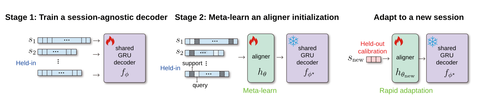

# FALCON_H2 Project Overview

## Project Summary

This repository contains the code, experiments, and model checkpoints for the paper **Few-Shot Cross-Day Neural Decoding of Attempted Handwriting (NeurIPS 2026)**. For detailed instructions on how to reproduce our results, see [Reproduction Guide](reproduction.md).

### Research Problem

Intracortical brain-computer interfaces (iBCIs) suffer from **neural drift** — recording signals change across days, degrading decoder performance. The standard approach trains a session-specific input layer jointly with a shared decoder. However, this underperforms in the **extreme few-shot regime**, where each new session provides only **3 calibration sentences**.

### Core Method: Two-Stage Training

This work proposes a **two-stage few-shot neural decoding** approach:

| Stage | Description | Purpose |
|-------|-------------|---------|
| **Stage 1** | Train a **session-agnostic GRU backbone** on pooled held-in sessions (no session-specific layer). | Encourage the backbone to learn cross-session shared representations directly, rather than offloading variability to session-specific layers. |
| **Stage 2** | Freeze the Stage 1 backbone and meta-learn a lightweight **input aligner** using First-Order **MAML** (Model-Agnostic Meta-Learning). | Enable the aligner to rapidly adapt to a new session with only a few gradient steps. |

For a new held-out session, the aligner is adapted using only 3 calibration sentences via **rapid adaptation** (25 gradient steps), while the backbone remains frozen. This updates only ~**0.15%** of the total parameters.



### Key Results

On the **FALCON H2** benchmark (human handwriting iBCI dataset, 21 held-in sessions + 5 held-out sessions). Values are mean ± s.d. across the five held-out sessions (Table 1). See the [FALCON website](https://snel-repo.github.io/falcon/) and the [EvalAI leaderboard](https://eval.ai/web/challenges/challenge-page/2319/overview).

| Method | Class | WER w/o LM ↓ | WER w/ LM ↓ |
|--------|-------|-------------|-------------|
| Session-specific layer | ZS | 63.35 ± 12.77% | 26.99 ± 16.26% |
| Session-specific layer w/ fine-tuning | FSS | 54.62 ± 11.36% | 17.54 ± 8.49% |
| Stage 1: session-agnostic backbone | ZS | 50.14 ± 21.58% | 12.10 ± 12.09% |
| Stage 1: backbone + pooled-trained aligner | FSS | 48.08 ± 18.48% | 9.16 ± 7.12% |
| **Stage 1: backbone + meta-trained aligner** | **FSS** | **47.38 ± 18.44%** | **7.41 ± 5.44%** |
| Benchmark-provided baseline | ZS | 79 ± 8% | 39 ± 16% |
| CORP | TTA | — | 9 ± 7% |
| Oracle | OR | 23 ± 5% | 3 ± 2% |

ZS = zero-shot; FSS = few-shot supervised; TTA = test-time adaptation; OR = oracle. 

The benchmark-provided baseline and CORP are included for context rather than as architecture-matched controls. The oracle uses unreleased held-out calibration data and is not directly comparable to methods using only publicly released benchmark data.

---

## Directory Structure

```
FALCON_H2/
├── rnn/                        # Stage 1 & conventional model training code
├── maml_aligner/               # Stage 2 MAML aligner training code
└── falcon_submit/              # EvalAI submission code (incl. LM decoding)
```

Pretrained weights are not in this repository. Download them from the [GitHub Release](https://github.com/CIBR-Okubo-Lab/FALCON_H2_two_stage/releases) and extract them into `model_checkpoints/`.

---

## Directory Details

### 1. `rnn/` — GRU Backbone & Conventional Model Training

Contains the core training scripts and model definitions:

| File | Purpose | Corresponding Paper Section |
|------|---------|----------------------------|
| `neural_decoder_trainer.py` | Trains both the **Stage 1 session-agnostic GRU backbone** and the **conventional model with session-specific layers** (switch import to use `model_no_daylayer` or `model` / `model_linear`) | Sec 3.2, 3.3.1, Appendix B.1, C |
| `joint_aligner_trainer.py` | Trains the **Pooled-training Aligner** — initializes from a Stage 1 backbone, freezes the GRU, and trains an aligner on all held-in sessions pooled together | Appendix F.1 (pooled-training baseline) |
| `formatData_remote.ipynb` | Data preprocessing notebook — converts raw NWB files (DANDI 000950) into pickle format expected by training scripts | |
| `neural_decoder/` | Core modules | |
| ├ `model_no_daylayer.py` | `GRUDecoder` — Stage 1 session-agnostic backbone (no session-specific layer) | |
| ├ `model.py` | **Conventional model**: GRU with session-specific input layers (affine + softsign), jointly trained | Sec 3.2 |
| ├ `model_linear.py` | **Conventional model variant**: GRU with session-specific input layers (affine only, no softsign) | Appendix C.4 |
| ├ `joint_align.py` | `JointAligner` — loads a pre-trained backbone, freezes GRU params, trains only the aligner (used by `joint_aligner_trainer.py` for pooled training) | |
| ├ `dataset.py` | `SpeechDataModule` — data loading & preprocessing | |
| ├ `augmentations.py` | Data augmentation (white noise + random channel offsets) | Appendix A.3 |
| ├ `callbacks.py` | PyTorch Lightning callbacks (`TimerCallback`, `NanDetectorCallback`) | |
| `conf/` | Hydra configuration files | |
| ├ `config.yaml` | Stage 1 backbone and conventional-model training hyperparameters (same file; switch the model import) | Table 3, Table 5 |
| └ `align_config.yaml` | Pooled-training aligner hyperparameters (used by `joint_aligner_trainer.py`) | Appendix F.1 |
| `NeuralDecoder/` | Local evaluation and dataset utilities | |

**GRU Backbone Architecture** (Table 2 of paper):

| Hyperparameter | Value |
|----------------|-------|
| Stack size | 6 |
| Stack stride | 5 |
| GRU hidden size | 512 |
| Number of GRU layers | 5 |
| Dropout rate | 0.4 |
| Bidirectional | Yes |

### 2. `maml_aligner/` — Stage 2 MAML Aligner Training

> **Key difference from pooled training (`rnn/joint_aligner_trainer.py`):** Both share the same backbone + aligner architecture. The difference is **how the aligner is trained**: MAML treats each held-in session as a separate task with support/query splits and inner/outer loop optimization, while pooled training mixes all sessions together and trains the aligner directly.

| File | Purpose | Corresponding Paper Section |
|------|---------|----------------------------|
| `neural_decoder_trainer.py` | MAML aligner training script | Sec 3.3.2, Appendix B.2 |
| `fast_adaptation.ipynb` | Held-out session rapid adaptation notebook | Sec 3.4, Appendix B.3 |
| `evaluation.ipynb` | Model evaluation notebook (computes WER/CER) | |
| `neural_decoder/` | Core modules | |
| ├ `maml_align.py` | `MAMLAligner` model definition (inner-loop / outer-loop logic) | Algorithm 1 |
| ├ `dataset.py` | `MAMLDataModule` — MAML task sampling (support/query split) | |
| ├ `augmentations.py` | Data augmentation | |
| ├ `callbacks.py` | Callbacks | |
| `conf/` | Hydra configuration | |
| ├ `config.yaml` | MAML aligner hyperparameters (default: single-layer linear) | Table 4 |
| └ `wandb/` | W&B configuration | |

**MAML Hyperparameters** (Table 4 of paper):

| Hyperparameter | Single-layer aligner | 2-layer aligner |
|----------------|---------------------|-----------------|
| Number of batches | 100,000 | 100,000 |
| Inner-loop LR (α) | 0.005 | 0.07 |
| Outer-loop LR (β) | 0.002 | 0.007 |
| Inner-loop steps | 3 | 3 |
| Tasks per batch | 3 | 3 |
| Support set size | 5 | 5 |
| Query set size | 5 | 5 |
| Aligner hidden size | N/A | 96 |
| Aligner output dim | 192 | 192 |

### 3. `falcon_submit/` — EvalAI Submission Code

Used for submitting results to the FALCON benchmark EvalAI platform.

| File | Purpose |
|------|---------|
| `maml_3gram/` | Submission package |
| ├ `maml_3gram_sample.py` | Evaluation entry script (calls `FalconEvaluator`) |
| ├ `maml_3gram_decoder.py` | `MAMLLMDecoder` — full inference pipeline with LM decoding |
| ├ `maml_3gram_sample.Dockerfile` | Docker image build file |
| ├ `requirements_3gram.txt` | Python dependencies |
| └ `utils/` | Utility functions |
| &nbsp;&nbsp; ├ `lmDecoderUtils.py` | 3-gram LM + GPT-2 XL beam search + rescoring |
| &nbsp;&nbsp; └ `rnnEval.py` | RNN inference utilities |

**LM Decoding Hyperparameters** (Table 8 of paper):

| Parameter | Value |
|-----------|-------|
| Beam search min active states | 200 |
| Beam search max active states | 7000 |
| Beam size | 17 |
| Acoustic scale | 0.8 |
| αLM (RNN log prob scale) | 0.5 |
| βLM (3-gram / GPT-2 XL weight) | 0 |
| n-best outputs | 10 |
| Blank label penalty | log(11) |

### 4. Pretrained model weights

The five checkpoints used in the paper are distributed as GitHub Release assets, not as files in this repository. Download the archives from the [GitHub Release](https://github.com/CIBR-Okubo-Lab/FALCON_H2_two_stage/releases) and extract them into `model_checkpoints/`:

```bash
mkdir -p model_checkpoints
cd model_checkpoints
# place the downloaded run_*.tar.gz files here, then:
for f in run_*.tar.gz; do tar -xzf "$f"; done
```

Each archive contains `args` and `modelWeights`. The two aligner runs (`run_20260320-104023`, `run_20260417-124107`) also include `last.ckpt`. TensorBoard logs are not included.

| Checkpoint | Run ID | Model in Paper | Corresponding Figure/Table | WER w/ LM ↓ |
|-----------|--------|----------------|---------------------------|------------|
| `run_20260203-104333/` | run_20260203-104333 | **Session-specific layer** (affine + softsign, jointly trained) | Table 1 "Session-specific layer" (ZS) and "w/ fine-tuning" (FSS) | 26.99 ± 16.26% (ZS); 17.54 ± 8.49% (FSS) |
| `run_20250908-101130/` | run_20250908-101130 | **GRU Backbone** (Stage 1 only, session-agnostic) | Table 1 "Stage 1: session-agnostic backbone" | 12.10 ± 12.09% |
| `run_20260320-104023/` | run_20260320-104023 | **2-layer MAML Aligner** (Stages 1 & 2, main method) | Table 1 "backbone + meta-trained aligner" | **7.41 ± 5.44%** |
| `run_20260402-125444/` | run_20260402-125444 | **Pooled-training Aligner** (ablation baseline) | Fig 3a / Table 9 "pooled-training initialization" | 9.16 ± 7.12% |
| `run_20260417-124107/` | run_20260417-124107 | **Linear MAML Aligner** (ablation) | Fig 3b / Table 10 "linear MAML" | 10.80 ± 9.19% |


---

## Tech Stack

- **Deep Learning**: PyTorch + PyTorch Lightning
  - MAML aligner training: PyTorch **2.7.1** (requires `torch.nn.utils.stateless.functional_call`)
  - Stage 1 training, EvalAI submission, LM decoding: PyTorch **1.13**
- **Experiment Tracking**: Weights & Biases (W&B) + TensorBoard
- **Configuration**: Hydra
- **Distributed Training**: DDP (Distributed Data Parallel)
- **GPU**: Up to 4 × NVIDIA RTX 4090 (24 GB)
- **Training Time**: Backbone ~3h, MAML aligner ~40h (H2 dataset)

## Datasets

- **FALCON H2**: DANDI Dandiset 000950, version 0.241029.1403
- 192-channel intracortical recordings, 21 held-in sessions (287 days) + 5 held-out sessions (176 days)
- Only 3 calibration sentences released per held-out session
- 31-symbol vocabulary (26 lowercase letters + 4 punctuation marks + 1 space symbol)
- License: CC BY 4.0
